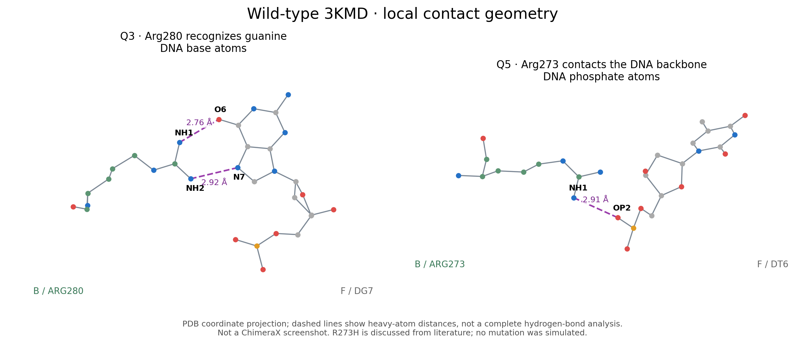
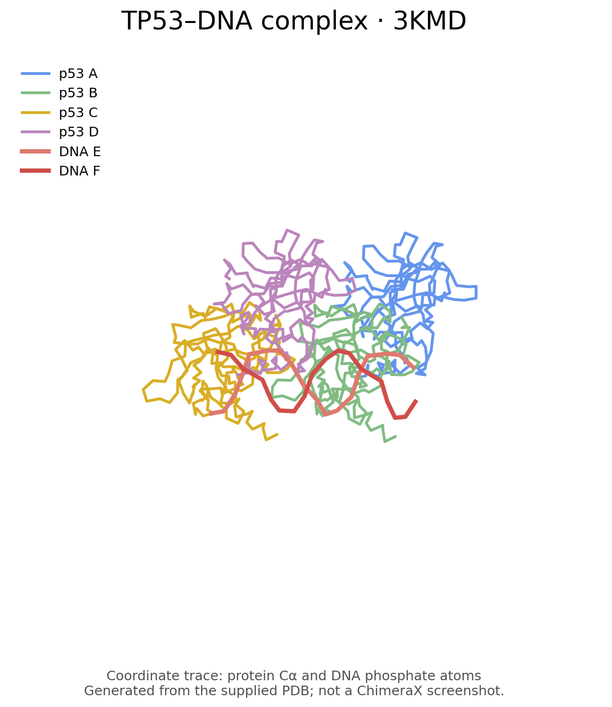

# Scientist’s Mission

**Who Stole TP53’s Superpower? Searching for the Key to Unlock Cancer**  
**Using AI to Uncover the Secrets of TP53–DNA Interactions**

姓名：待填　｜　學號：待填

依照 [paristzou/tp53abc 標準範例](https://github.com/paristzou/tp53abc) 整理以下五題作業架構。題目以中文摘要呈現；以下為依教材、公開研究與使用者提供的 3KMD 結構整理的參考答案。

## 1. The LEGO Assembly Line

胺基酸以哪種鍵連成蛋白質？請說明哪些胺基酸或主鏈基團之間可形成氫鍵。

**Answer:**

胺基酸之間以**肽鍵（peptide bond）**連接：一個胺基酸的羧基與下一個胺基酸的胺基形成共價的醯胺鍵，構成多肽主鏈。

氫鍵與肽鍵的角色不同。蛋白質二級結構常由主鏈的 **C=O 氧原子**與另一位置的 **N–H 氫原子**形成氫鍵；α 螺旋通常是第 i 個殘基的 C=O 與第 i+4 個殘基的 N–H 配對，β 摺板則由相鄰 β 股的主鏈基團配對。因此，氫鍵不是只會發生在某一組固定的胺基酸名稱之間。具有合適供體或受體的側鏈也能參與，例如 Ser、Thr、Asn、Gln、Asp、Glu、Lys、Arg、His、Tyr；是否形成氫鍵仍取決於距離、方向與質子化狀態。

在提供的 3KMD 中，一個主鏈例子是 **B 鏈 Cys277 的 O 與 Asp281 的 N**，重原子距離約 **2.96 Å**，符合 i→i+4 的 α 螺旋氫鍵排列。此數值為座標量測，並非 O–H 距離。

來源：[NCBI 蛋白質組成與二級結構](https://www.ncbi.nlm.nih.gov/books/NBK9879/)、[NCBI 蛋白質形狀與結構](https://www.ncbi.nlm.nih.gov/books/NBK26830/)。

## 2. The Double-Track Highway of Life’s Blueprint

請說明 DNA 雙股如何組成、核苷酸的基本成分、螺旋方向、四種鹼基，以及鹼基之間的氫鍵配對。

**Answer:**

DNA 的基本單位是**去氧核苷酸**，每個單位包含去氧核糖、磷酸與一個含氮鹼基。同一股相鄰核苷酸以 **3′–5′ 磷酸二酯鍵**相連，形成糖–磷酸骨架。兩股方向相反，一股為 5′→3′，另一股為 3′→5′，以互補鹼基配對組成雙螺旋；鹼基堆疊也對穩定性有重要貢獻。

四種鹼基是**腺嘌呤 A、胸腺嘧啶 T、鳥嘌呤 G、胞嘧啶 C**。典型 Watson–Crick 配對中，**A–T 有兩個氫鍵，G–C 有三個氫鍵**。

細胞內常見的 **B 型 DNA 是右手螺旋**；DNA 並非所有構型都右旋，例如 Z 型 DNA 是左旋。3KMD 的原始研究描述其 DNA 大致為 B 型，因此本題所觀察的 DNA 可判定為右手螺旋。

來源：[NHGRI DNA 基本組成](https://www.genome.gov/about-genomics/fact-sheets/Deoxyribonucleic-Acid-Fact-Sheet)、[NCBI DNA 雙股結構](https://www.ncbi.nlm.nih.gov/books/NBK26821/)、[NCBI 鹼基配對與氫鍵](https://www.ncbi.nlm.nih.gov/books/NBK538241/)、[3KMD 原始結構與研究](https://www.rcsb.org/structure/3KMD)。

## 3. A 20-Base-Pair Love Code

以 **3KMD** 結構找出一組互相作用的 TP53 胺基酸與 DNA 鹼基，說明它們如何參與辨識。

**Answer:**

一組可直接由提供的 3KMD 座標確認的例子是：**TP53 的 B 鏈 Arg280（精胺酸）與 DNA 的 F 鏈 DG7（第 7 個去氧鳥苷，其鹼基為鳥嘌呤 G）**。

Arg280 的胍基可向鳥嘌呤的 O6 與 N7 提供氫鍵。本檔案的實測重原子距離如下：

| TP53 原子 | DNA 原子 | 距離 |
| --- | --- | --- |
| B/ARG280/NH1 | F/DG7/O6 | 2.76 Å |
| B/ARG280/NH2 | F/DG7/N7 | 2.92 Å |

這兩組接觸與 **Arg–guanine 雙齒氫鍵辨識**一致，可協助 TP53 辨識 DNA 大溝中鳥嘌呤的化學特徵。單一接觸不能完整解釋序列專一性；其他殘基、DNA 形狀與蛋白質四聚體協同性也參與其中。

以上鏈名與編號依使用者提供的 PDB（作者編號），數值是 N/O 重原子間距，並非氫原子距離；距離本身不能取代完整的氫鍵角度與質子化判定。

來源：本機 3KMD 座標量測；[3KMD 結構](https://www.rcsb.org/structure/3KMD)；[p53–DNA 原始研究中對 Arg280–guanine 辨識的描述](https://pmc.ncbi.nlm.nih.gov/articles/PMC3783167/)。

## 4. Return to the Crime Scene

為什麼單一胺基酸改變可能造成嚴重疾病？請舉一個具體疾病例子並解釋。

**Answer:**

胺基酸的側鏈大小、電荷與親疏水性會影響蛋白質的摺疊、穩定性、催化或結合能力。若突變發生在關鍵位置，即使只改變一個胺基酸，也可能破壞重要接觸或造成異常聚集，進而導致疾病；但並不是每個胺基酸改變都會致病。

具體例子是**鐮刀型紅血球疾病**中的血紅素 S。β-珠蛋白傳統成熟鏈編號的 **Glu6→Val（E6V）**，使原本帶負電、親水的麩胺酸換成疏水的纈胺酸。去氧狀態下，這個改變促進血紅素分子異常聚合，令紅血球變硬並呈鐮刀狀，造成溶血性貧血及血管阻塞。典型鐮刀型貧血與兩個 HbS 等位基因相關；只有一個 HbS 等位基因通常稱為帶因狀態，不能直接等同於相同嚴重程度的疾病。

來源：[NCBI 血紅素 S 定義與 E6V](https://www.ncbi.nlm.nih.gov/mesh/68006451)、[NHLBI 血紅素聚合與紅血球形狀](https://www.nhlbi.nih.gov/sites/default/files/publications/sickle_cell_disease_milestones.pdf)、[NHLBI 遺傳與致病機制](https://www.nhlbi.nih.gov/health/sickle-cell-disease/causes)。

## 5. Return to the Crime Scene: Searching for Clues

在 **3KMD** 中選擇一個與癌症相關的 TP53 胺基酸突變，使用 ChimeraX 判斷該位置在蛋白質–DNA 接觸面或蛋白質其他區域。

**Answer:**

選擇的突變是 **TP53 p.R273H**，即第 273 位由精胺酸（Arg，R）變為組胺酸（His，H）；這是已知與癌症相關的 DNA 接觸型熱點突變。

在使用者提供的**野生型 3KMD** 中，B 鏈 Arg273 位於蛋白質表面、緊鄰 DNA 糖–磷酸骨架。其 **NH1 與 F 鏈 DT6 的 OP2** 距離約 **2.91 Å**；NH2 與同一個 OP2 約 **3.24 Å**。因此，該位置屬於**蛋白質–DNA 接觸面**，而不是埋藏在蛋白質內部的核心位置。注意：這裡接觸的是核苷酸的**磷酸骨架**，不是胸腺嘧啶鹼基本身；第 3 題則使用直接接觸鹼基的 Arg280 作例子。

Arg273 原本較長、帶正電的胍基有利於接觸帶負電的 DNA 骨架。換成 His 後，側鏈的幾何形狀與質子化性質改變，難以維持原本的接觸。公開的突變結構研究指出，R273H 可以在不明顯扭曲鄰近結構的情況下削弱 DNA 接觸。這可能降低 p53 對相關基因的轉錄調控能力，使受損細胞較難正常停止分裂或進入細胞凋亡，從而促進癌症發展。

此處以野生型座標判讀**突變發生的位置**，並以研究支持突變機制；目前沒有把 3KMD 改造成 R273H，也沒有把野生型量測宣稱為突變後的實測結果。位置結論已由座標確認；ChimeraX 中標示位置的正式截圖仍待補。

來源：[NCI TP53 資料庫 R273H](https://tp53.cancer.gov/mut_details?mut_id=3737)、[NCI DNA 接觸與穩定性資料](https://tp53.cancer.gov/stability)、[Joerger 等人的原始突變結構研究](https://www.rcsb.org/structure/2BIM)。2BIM 為含穩定化背景突變的研究結構，不能視為單一 R273H 的 3KMD–DNA 複合體。

### a. ChimeraX 視覺化圖片

正式 ChimeraX 截圖待補。第 3、5 題的量測與位點示意如下；這是由 PDB 座標繪製的圖，不是 ChimeraX 螢幕截圖。

整體結構預覽：

### b. ChimeraX 工作階段

已建立並驗證可開啟的整體結構工作階段：[ChimeraX/TP53.cxs](ChimeraX/TP53.cxs)。此檔仍是原本的整體視圖。可另開啟 [位點標示指令](ChimeraX/inspect_contacts.cxc) 顯示 Arg273、Arg280 與距離，再依課程規定另存為自己的 `StudentID.cxs`。位點指令尚未在目前受限環境執行驗證。

---

# 結構檔與操作說明

## 檔案

| 路徑 | 說明 |
| --- | --- |
| [structures/tp53_tetramer.pdb](structures/tp53_tetramer.pdb) | 原始 3KMD 結構；蛋白質鏈 A–D、DNA 鏈 E–F，含水分子及鋅離子 |
| [structures/tp53.pdb](structures/tp53.pdb) | 使用者提供的蛋白質鏈 B 結構 |
| [structures/tp53_DNA.pdb](structures/tp53_DNA.pdb) | 使用者提供的 DNA 鏈 E、F 結構 |
| [ChimeraX/TP53.cxs](ChimeraX/TP53.cxs) | 用 ChimeraX 1.12 建立的工作階段；已驗證可重新開啟 |
| [ChimeraX/view_tp53.cxc](ChimeraX/view_tp53.cxc) | 可重新建立檢視樣式的 ChimeraX 指令 |

## 在 ChimeraX 開啟

1. 下載並解壓縮整個儲存庫。
2. 在 ChimeraX 使用 **File → Open** 開啟 `ChimeraX/TP53.cxs`。
3. 工作階段以 cartoon 顯示蛋白質，DNA 使用 stick；水分子已從工作階段移除，原始 PDB 檔完整保留。
4. 若課程要求學號檔名，使用 **File → Save** 另存為自己的 `學號.cxs`。
5. 調整角度後，可在 ChimeraX 命令列輸入 `save ~/Desktop/tp53_chimerax.png width 1600 height 1200 supersample 3` 輸出正式截圖。

## 結構來源

`tp53_tetramer.pdb` 的 HEADER 記載結構編號為 **3KMD**，TITLE 為 *Crystal structure of the P53 core domain bound to a full consensus site as a self-assembled tetramer*，檔案記載解析度為 **2.15 Å**。詳細來源請參閱 [RCSB PDB 3KMD](https://www.rcsb.org/structure/3KMD)。

上述結構資訊直接讀自使用者提供的 PDB；未將教學影片作者的圖片、作業答案或工作階段檔複製到此專案。
